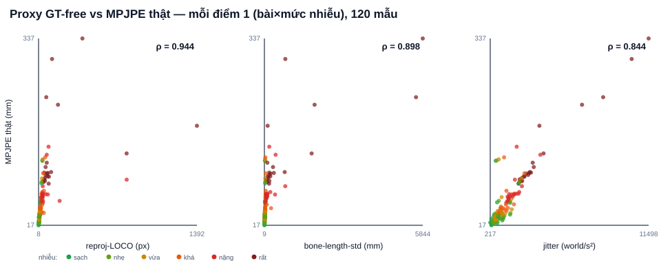

# Kiểm chứng proxy GT-FREE trên AIST++ (tương quan với MPJPE thật)

> Sinh tự động bởi `experiments/aist_proxy_validation.py`. Mỗi mẫu = (bài × mức nhiễu). Dựng DLT KHÔNG trọng số, tập con 4 camera (0, 2, 4, 6), STRIDE=6.

- **120 mẫu** (20 bài × 6 mức nhiễu), COCO-17 không remap, đơn vị→mm (×10).

- MPJPE 'thế giới' (KHÔNG căn gốc — cùng hệ world với 3D tham chiếu 9-view).

## Tương quan hạng Spearman ρ (proxy vs MPJPE thật)

ρ→1: proxy xếp hạng chất lượng ĐỒNG THUẬN với GT ⇒ chấm GT-free hợp thức.

| Proxy GT-free | ý nghĩa | ρ Spearman |
|---|---|---:|
| reproj-LOCO (tb) | sai số tái chiếu leave-one-cam-out | 0.944 |
| reproj-LOCO (độ lệch fold) | bất định giữa các fold | 0.740 |
| bone-length-std | xương 'co giãn' do nhiễu | 0.898 |
| jitter (gia tốc) | rung/giật quỹ đạo | 0.844 |

## Trung bình theo mức nhiễu (dải chất lượng)

| Mức nhiễu | MPJPE thật (mm) | reproj-LOCO (px) | LOCO-std (px) | bone-std (mm) | jitter |
|---|---:|---:|---:|---:|---:|
| sạch | 36.4 | 15.7 | 3.56 | 22.6 | 764 |
| nhẹ 2px | 38.7 | 16.7 | 3.50 | 24.3 | 838 |
| vừa 4px+1% | 44.3 | 19.3 | 3.43 | 28.6 | 991 |
| khá 6px+2%+3% | 53.4 | 32.0 | 8.56 | 50.7 | 1248 |
| nặng 10px+4%+6% | 76.8 | 94.1 | 85.09 | 157.4 | 1914 |
| rất nặng 15px+6%+10% | 143.0 | 201.0 | 207.10 | 960.6 | 4153 |

## Đọc kết quả

- Proxy bám MPJPE thật mạnh nhất: **reproj-LOCO** (ρ=0.944). Proxy càng tăng, sai số thật càng tăng — đúng kỳ vọng.

- Vì xếp hạng theo proxy ≈ xếp hạng theo GT, có thể dùng proxy để so 1-cam vs 2-cam vs sau-cleanup trên clip TỰ QUAY (không GT) — hợp thức hoá tầng chấm Đường B.

- MPJPE tuyệt đối ở đây CAO hơn 2 sweep kia vì DLT thô KHÔNG trọng số/không làm mượt (cô lập quan hệ nhiễu→lỗi); kết luận là về TƯƠNG QUAN, không phải mức tuyệt đối.

